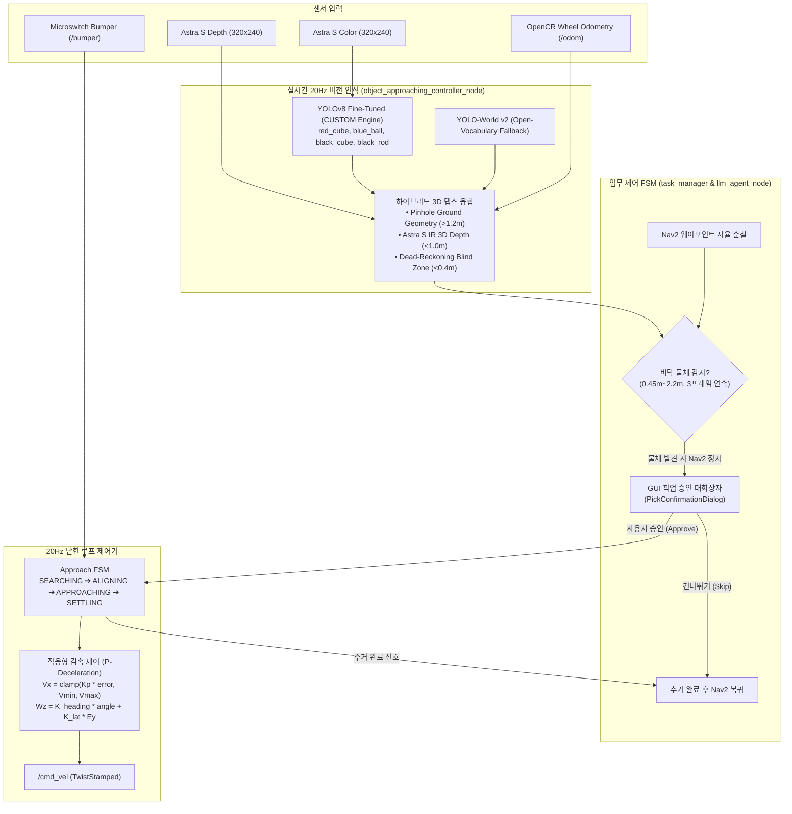
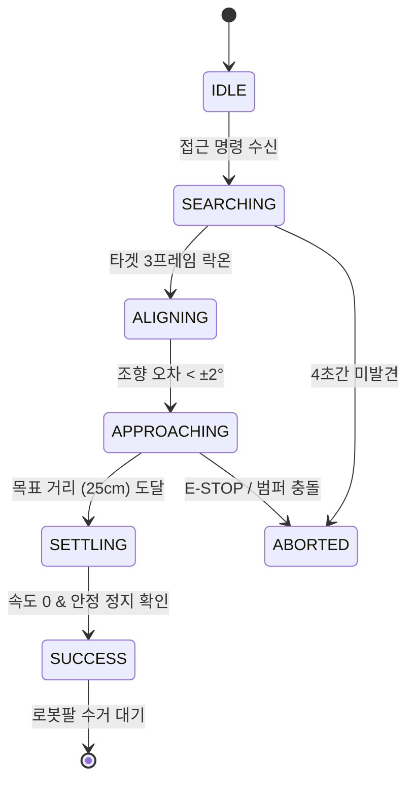

# 🤖 바닥 타겟 물체 정밀 접근 (Floor Object Approach) 시스템 명세서

본 문서는 TurtleBot3 Waffle Pi 로봇이 바닥에 놓인 소형 물체(큐브, 공, 막대 등)를 원거리에서 발견하고, 자율주행 중단 후 cm 단위로 정밀하게 접근하여 정지하는 **Floor Object Approach & Visual Servoing 시스템**의 구조와 알고리즘을 설명합니다.

---

## 📌 1. 시스템 아키텍처 개요

시스템은 **[지능 인식 계층] ➔ [임무 스케줄링 계층] ➔ [실시간 서보잉 제어 계층] ➔ [모빌리티 하드웨어 계층]**의 4단계 파이프라인으로 구성됩니다.



---

## 🔍 2. 하이브리드 3D 거리 측정 알고리즘 (Hybrid Depth Perception)

Astra S 카메라의 물리적 특성(IR 뎁스 유효 거리 0.6m~3.0m, 지면 반사 노이즈, 근접 사각지대)을 극복하기 위해 **3단계 하이브리드 기하학 융합**을 사용합니다.

```text
 ┌─────────────────┬─────────────────┬──────────────────────┐
 │  ~ 0.40m 이하   │  0.40m ~ 1.20m  │     1.20m 이상       │
 │   사각지대 영역 │    안정적 영역  │     원거리 영역      │
 ├─────────────────┼─────────────────┼──────────────────────┤
 │ 오도메트리 기반 │ Astra S IR 뎁스 │ 단안 지면 핀홀 투영  │
 │ 공간 기억 추정  │ + 지면 기하 융합│ (Pinhole Ground Proj)│
 │ [DEAD-RECKONING]│    [IR 3D]      │       [GEOM]         │
 └─────────────────┴─────────────────┴──────────────────────┘
```

### 1) 원거리: 단안 지면 핀홀 기하학 (`[GEOM]`)
물체가 1.2m 이상 멀리 떨어져 있을 때는 IR 깊이 센서의 바닥 반사 오차가 커지므로, 물체가 바닥면과 접촉하는 최하단 픽셀 좌표($v_{\text{bottom}}$)와 카메라 장착 높이($h = 14.7\text{cm}$), 물리적 피치 기울기 각도($\theta_{\text{pitch}} = +4.2^\circ$)를 바탕으로 삼각 기하학을 적용합니다:

$$\alpha = \arctan\left(\frac{v_{\text{bottom}} - c_y}{f_y}\right)$$
$$d_z = \frac{h_{\text{lens}}}{\tan(\alpha + \theta_{\text{pitch}})}$$

### 2) 중근거리: Astra S Structured Light 3D 뎁스 (`[IR 3D]`)
물체가 0.4m ~ 1.2m 구간에 있을 때는 물체 바운딩 박스 중앙 $7\times 7$ 픽셀의 깊이 유효값(IQR 필터링)을 추출하여 1cm 단위의 정확한 거리를 획득합니다.

### 3) 극근거리 블라인드 존: 오도메트리 공간 기억 데드레코닝 (`[DEAD-RECKONING]`)
로봇이 목표 정지 거리(25cm)까지 접근하면, 카메라 화각 아래(후드 밑)로 물체가 사라지게 됩니다. 
* 물체 거리가 40cm 이하가 되는 순간 로봇의 마지막 유효 $(X_{\text{odom}}, Y_{\text{odom}})$ 위치를 래칭(Latch)합니다.
* 영상에서 물체를 놓치더라도 휠 엔코더 적분치를 통해 남은 15cm 거리를 안정적으로 저속(3.5cm/s) 직진 주행하여 목표 거리에서 정확히 멈춥니다.

---

## 🚦 3. 자율주행 순찰 중 자동 발견 인터럽트 (Patrol Intercept)

로봇이 특정 방이나 목적지로 Nav2 자율주행 중일 때, 바닥에 떨어진 물체를 발견하면 자동으로 반응하는 프로세스입니다:

1. **지속적 백그라운드 스캔**:
   - 로봇이 주행 중일 때 `object_approaching_controller_node`가 20Hz로 카메라 영상을 감시합니다.
2. **신뢰도 연속 검증**:
   - 일시적인 노이즈나 잘못된 검출을 방지하기 위해 **거리 $0.45\text{m} \sim 2.20\text{m}$**, **신뢰도 $0.65$ 이상**으로 **최소 3프레임 연속 감지**되었을 때만 이벤트를 발생시킵니다.
3. **Nav2 주행 즉각 취소 & 모터 정지**:
   - 조건 충족 시 `/floor_object/detected_event` 토픽이 발행됩니다.
   - `task_manager`가 현재 Nav2 자율주행 목표(Goal)를 일시정지하고 로봇을 제자리에 멈춥니다.
4. **GUI 사용자 승인 대화상자**:
   - `PickConfirmationDialog` 창이 뜨며 발견된 물체 이름, 거리, 사진과 함께 승인 대기 카운트다운(15초)을 시작합니다.
   - **승인(Approve)**: 물체 정밀 접근 서보잉을 시작하여 25cm 앞까지 이동.
   - **건너뛰기(Skip)**: 물체를 무시하고 원래 목적지로 Nav2 주행 복귀.

---

## 🔄 4. 정밀 접근 제어기 FSM (Finite State Machine)



* **`ALIGNING`**: 전진하지 않고 제자리에서 회전하여 타겟이 카메라 정중앙($|E_y| < 2\text{cm}$)에 오도록 각도를 정렬합니다.
* **`APPROACHING`**:
  - 부드러운 P-감속 제어를 적용합니다:
    $$v_x = \text{clamp}(K_p \cdot (d_z - d_{\text{target}}), 0.035, 0.065)\quad [\text{m/s}]$$
    $$\omega_z = K_{\text{heading}} \cdot \theta_{\text{err}} + K_{\text{lat}} \cdot E_y\quad [\text{rad/s}]$$
  - 거리가 좁혀질수록 자연스럽게 감속하여 급정거로 인한 차체 흔들림을 원천 차단합니다.
* **`SETTLING`**: 25cm에 도달하면 속도를 0으로 유지하고 0.5초간 대기하며 완전히 정지했는지 확인합니다.
* **`SUCCESS`**: GUI에 수거 알림을 띄우고, 로봇팔 수거 완료 신호(`PICK_COMPLETED`)를 기다립니다.

---

## 🛡️ 5. 안전 장치 (Safety Features)

1. **하드웨어 마이크로스위치 범퍼 센서**:
   - 전면 범퍼가 물리적으로 물체나 장애물에 닿는 순간 즉시 전원 차단 수준으로 모터를 정지시킵니다.
2. **동적 타임아웃 가드**:
   - 접근 중 6초 이상 목표 거리에 도달하지 못하거나 바닥 물체가 가려지면 작업을 강제 중단하고 안전 정지합니다.
3. **GUI 비상 정지 (Emergency Stop)**:
   - UI 우측 상단의 빨간색 [긴급 정지] 버튼 클릭 시 즉시 0 속도 발행 및 모든 FSM이 ABORT 됩니다.
