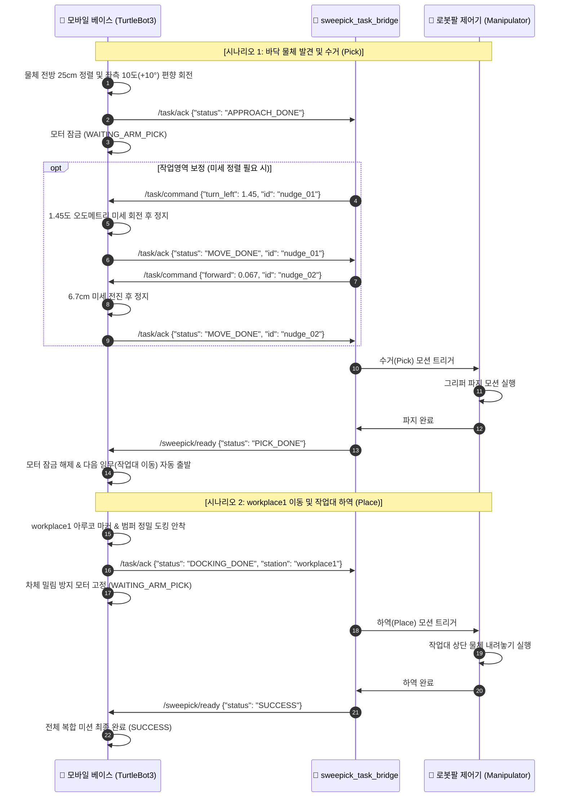

# 🤖 [모바일 로봇 ↔ 로봇팔] 협동 자율 모바일 매니퓰레이션 통신 프로토콜 명세서

본 문서는 **TurtleBot3 모바일 베이스**와 **협동 로봇팔(매니퓰레이터)** 간의 실시간 ROS 2 핸드셰이크 프로토콜, 명령 및 응답 규격(JSON Schema), 상태 전이(FSM) 흐름, 그리고 예외 처리 정책을 정의한 공식 기술 명세서입니다.

---

## 📌 1. 시스템 통신 아키텍처 개요

시스템은 **[모바일 자율주행/도킹 엔진]**과 **[로봇팔 모션 제어기]** 간의 비동기 메시지 기반 느슨한 결합(Loosely-Coupled) 구조로 설계되어 있으며, 네트워크 단절 및 레이스 컨디션을 방지하는 안전 가드가 포함되어 있습니다.



---

## 💻 1.1. 통신 주관 핵심 소스 코드 매핑

모바일 베이스와 로봇팔 간의 통신은 아래 4개의 핵심 파이썬 노드가 분담하여 주관합니다:

| 역할 구분 | 노드명 (Node) | 주관 소스 코드 | 주관 기능 및 핵심 역할 |
| :---: | :--- | :--- | :--- |
| **모바일 제어 (총괄)** | `task_manager_node` | `task_manager.py` | • **통신 관제탑**: `/task/ack` 발행 및 로봇팔 명령(`/task/command`, `/sweepick/ready`) 총괄 수신<br/>• 로봇팔 작업 중 차체 고정 잠금(`WAITING_ARM_PICK`) 및 미세 이동(`NAVIGATE_RELATIVE`) 실행 |
| **바닥 물체 접근** | `object_approaching_controller_node` | `object_approaching_controller_node.py` | • 바닥 물체(1.2m 이내) 감지 이벤트 방출(`_on_floor_object_detected_event`)<br/>• 물체 전방 25cm 정밀 정렬 완료(`APPROACHED`) 판정 및 task_manager 보고 |
| **작업대 도킹** | `precision_docking_controller_node` | `precision_docking_controller_node.py` | • workplace1 마커/범퍼 정밀 도킹 안착(`DOCKED`) 판정 및 task_manager 보고 |
| **로봇팔 브리지** | `sweepick_task_bridge` | `sweepick_task_bridge.py` | • 로봇팔 측 관제 노드: 모바일 베이스 `/task/ack` 수신<br/>• 작업영역 기반 베이스 미세 이동 계산 및 발행(`send()`), 수거/하역 완료(`ready`) 보고 |

---

## 📡 2. ROS 2 토픽 인터페이스 총괄표 및 코드 위치

| 방향 | 토픽명 (Topic) | 메시지 타입 | 주기 / 성격 | 주관 코드 및 발행/수신 라인 |
| :---: | :--- | :---: | :---: | :--- |
| **모바일 $\rightarrow$ 로봇팔** | **`/task/ack`** | `std_msgs/msg/String` | 이벤트성 | **발행**: `task_manager.py` (L313: 도킹완료, L356: 바닥접근완료, L1655: 미세이동완료)<br/>**수신**: `sweepick_task_bridge.py` (L215: `on_ack`) |
| **로봇팔 $\rightarrow$ 모바일** | **`/task/command`** | `std_msgs/msg/String` | 이벤트성 | **발행**: `sweepick_task_bridge.py` (L239: `self.cmd.publish`)<br/>**수신**: `task_manager.py` (L406: `_task_command_callback`) |
| **로봇팔 $\rightarrow$ 모바일** | **`/sweepick/ready`** | `std_msgs/msg/String` | 이벤트성 | **발행**: `sweepick_task_bridge.py` (L290, L305: `self.ready.publish`)<br/>**수신**: `task_manager.py` (L379: `_sweepick_ready_callback`) |
| **로봇팔 $\rightarrow$ 모바일** | **`/sweepick/heartbeat`** | `std_msgs/msg/String` | 2.0 Hz 주기 | **발행**: `sweepick_task_bridge.py` (L213: `beat()` 타이머)<br/>**수신**: `task_manager.py` (L375: `_arm_heartbeat_callback`) |

---

## 📄 3. 세부 메시지 페이로드 규격 (JSON Schema)

### 3.1. 모바일 로봇 $\rightarrow$ 로봇팔 (`/task/ack`)

로봇팔 노드는 `status`와 `id` 필드를 통해 수신된 신호의 종류를 식별(De-mux)합니다.

#### A. 바닥 물체 앞 25cm 정렬 완료 (발행 위치: `task_manager.py:L356`)
```json
{
  "id": "approach",
  "state": "done",
  "status": "APPROACH_DONE",
  "timestamp": 1793181615.123
}
```

#### B. workplace1 정밀 도킹 안착 완료 (발행 위치: `task_manager.py:L313`)
```json
{
  "id": "docking",
  "state": "done",
  "status": "DOCKING_DONE",
  "station": "workplace1",
  "timestamp": 1793181820.456
}
```

#### C. 베이스 미세 이동(Inching) 완료 응답 (발행 위치: `task_manager.py:L1655`)
```json
{
  "id": "swp30356-60291-1",
  "state": "done",
  "status": "MOVE_DONE",
  "dx_cm": 6.7,
  "dyaw_deg": 1.4
}
```
* **특징**: 로봇팔이 이동 명령에 부여했던 고유 `id`가 그대로 반환되어, 명령과 완료 응답이 1:1로 보장됩니다.

---

### 3.2. 로봇팔 $\rightarrow$ 모바일 로봇 (`/task/command`)
* **발행 주체**: `sweepick_task_bridge.py:L239` (`self.cmd.publish`)
* **수신 및 처리**: `task_manager.py:L406-L466` (`_task_command_callback` ➔ `NAVIGATE_RELATIVE` 변환)

로봇팔의 작업 영역(Reachable Envelope)에 맞춰 모바일 베이스를 cm/도 단위로 미세 조작합니다.

#### A. 초간단 단축키 포맷 (권장)
* **전진 (단위: m, 최대 10cm 제한)**:
  ```json
  {"forward": 0.05, "id": "nudge_01"}
  ```
* **후진 (단위: m, 최대 10cm 제한)**:
  ```json
  {"backward": 0.03, "id": "nudge_02"}
  ```
* **좌회전 (단위: deg, 최대 30도 제한)**:
  ```json
  {"turn_left": 1.45, "id": "nudge_03"}
  ```
* **우회전 (단위: deg, 최대 30도 제한)**:
  ```json
  {"turn_right": 5.0, "id": "nudge_04"}
  ```

#### B. 표준 액션 포맷
```json
{"action": "FORWARD", "distance": 0.05, "id": "nudge_05"}
{"action": "TURN_LEFT", "angle": 1.45, "id": "nudge_06"}
```

#### C. 물체 관측 실패 시 시각 재접근 요청 포맷 (Re-approach)
* **목적**: 로봇팔 카메라가 물체를 놓쳐 미세 이동 수치를 계산할 수 없을 때, 모바일 베이스의 Astra 카메라로 물체를 다시 포착하여 25cm 정밀 재접근을 수행하도록 요청.
* **명령 규격 (한 줄 JSON)**:
  ```json
  {"action": "REAPPROACH", "id": "retry_01"}
  ```
  *(※ `{"action": "RETRY_APPROACH", "id": "retry_01"}` 또는 `/sweepick/ready`의 `{"status": "REAPPROACH", "id": "retry_01"}`도 호환 지원)*
* **모바일 로봇 동작 흐름**:
  1. 베이스가 **22cm 안전 후진** 및 **-10° 회전(각도 원복)**을 수행하여 물체를 Astra 카메라 황금 화각(약 45~50cm) 정중앙에 재배치합니다.
  2. 바닥 시각 제어기(`object_approaching_controller`)가 자동으로 재가동되어 **전방 25cm 정밀 재접근 + 좌측 10도 재정렬**을 수행합니다.
  3. 완료 시 로봇팔로 다시 `/task/ack` `{"id": "retry_01", "state": "done", "status": "APPROACH_DONE"}` 신호를 반환합니다.

---

### 3.3. 로봇팔 $\rightarrow$ 모바일 로봇 (`/sweepick/ready`)
* **발행 주체**: `sweepick_task_bridge.py:L290, L305` (`self.ready.publish`)
* **수신 및 처리**: `task_manager.py:L379-L404` (`_sweepick_ready_callback` ➔ `_resume_paused_navigation`)

로봇팔 작업의 종료 상태를 모바일 로봇에 전달하여 다음 주행 단계로 인계합니다.

#### A. 작업 정상 완료 (수거 완료 or 하역 완료)
```json
{"status": "PICK_DONE"}
```
*(※ 하역 완료 시 `"SUCCESS"`, `"ACTION_DONE"`, `"DOCK_TASK_DONE"`, `"DONE"` 모두 호환 지원)*

#### B. 작업 실패 / 비상 정지 요청
```json
{
  "status": "ERROR",
  "reason": "Gripper payload dropped during pick"
}
```
* **모바일 로봇 동작**: 베이스는 안전을 위해 절대 출발하지 않고 현 위치에서 비상 정지 잠금을 유지합니다.

---

### 3.4. 로봇팔 생존 신호 (`/sweepick/heartbeat`)

```json
{
  "src": "sweepick_task_bridge",
  "seq": 1024,
  "t": 1793181615.566,
  "phase": "idle",
  "dry_run": false
}
```
* `phase`: `"idle"` (대기), `"observing"` (물체 확인), `"moving"` (베이스 이동 유도), `"ready"` (팔 동작 중)

---

## 🛡️ 4. 안전 정책 및 예외 처리 (Safety & Failsafe)

1. **상호 침범 방지 모터 잠금 (Zero-Velocity Lock)**:
   * 물체 앞 25cm 도착 또는 도킹 안착 시, 모바일 로봇은 FSM을 `WAITING_ARM_PICK`으로 전환하고 모터 출력(`cmd_vel`)을 `0.0`으로 연속 강제하여 로봇팔 작업 중 차체가 밀리는 현상을 원천 차단합니다.
2. **미세 이동 안전 리미터**:
   * 로봇팔이 네트워크 오류나 계산 착오로 큰 값을 보내더라도, 모바일 로봇 내부 가드에서 **1회 이동당 최대 10cm(0.10m), 최대 회전 30도(30.0°)**로 강제 클램핑(Clamping)하여 실내 충돌을 방지합니다.
3. **독립 단독 테스트 지원 (Arm-Offline Bypass)**:
   * 로봇팔 노드가 켜져 있지 않은 상태(하트비트 미수신)에서 모바일 로봇을 단독 테스트할 경우, 도킹 안착 후 무한 대기에 빠지지 않고 2초 후 자동 `SUCCESS` 처리되어 단독 주행 테스트가 가능합니다.
4. **오동작 방지 주행 중 신호 필터링**:
   * 모바일 로봇이 고속 주행(`NAVIGATING`) 중일 때 로봇팔에서 예기치 않게 `READY` 신호가 들어오더라도, 주행을 중단하지 않고 정상 경로를 계속 유지하도록 보호 가드가 적용되어 있습니다.

---

## 💻 5. 로봇팔 측 구현 예제 (Python Reference Code)

```python
import rclpy
from rclpy.node import Node
from std_msgs.msg import String
import json

class ArmCooperativeBridge(Node):
    def __init__(self):
        super().__init__('arm_cooperative_bridge')

        # 1. 모바일 로봇 도착/완료 신호 수신
        self.create_subscription(String, '/task/ack', self.on_base_ack, 10)

        # 2. 모바일 베이스 미세 이동 명령 발행
        self.cmd_pub = self.create_publisher(String, '/task/command', 10)

        # 3. 로봇팔 작업 완료 보고 발행
        self.ready_pub = self.create_publisher(String, '/sweepick/ready', 10)

        self.last_nudge_id = None

    def on_base_ack(self, msg: String):
        try:
            data = json.loads(msg.data)
            status = data.get("status")
            ack_id = data.get("id")

            # 케이스 1: 바닥 물체 앞 25cm 도착
            if status == "APPROACH_DONE":
                self.get_logger().info("🎯 [바닥 물체 앞 정지 확인] 카메라 검증 후 필요시 미세정렬 또는 집기 시작")
                # 필요 시: self.request_nudge(forward=0.03)
                self.execute_arm_pick()

            # 케이스 2: 베이스 미세 이동(Inching) 완료
            elif status == "MOVE_DONE":
                if ack_id == self.last_nudge_id:
                    self.get_logger().info(f"✅ 미세 이동({ack_id}) 완료 확인! 집기/하역 진행")
                    self.execute_arm_pick()

            # 케이스 3: workplace1 작업대 도킹 안착 완료
            elif status == "DOCKING_DONE":
                self.get_logger().info("🎯 [workplace1 도킹 안착 확인] 작업대 하역(Place) 시작")
                self.execute_arm_place()

        except Exception as e:
            self.get_logger().error(f"ACK 파싱 오류: {e}")

    def request_nudge(self, forward=0.0, turn_left=0.0):
        """베이스 미세 조정 요청"""
        self.last_nudge_id = f"nudge_{int(self.get_clock().now().nanoseconds / 1e6)}"
        cmd = {"id": self.last_nudge_id}
        if forward != 0.0:
            cmd["forward"] = float(forward)
        if turn_left != 0.0:
            cmd["turn_left"] = float(turn_left)
        self.cmd_pub.publish(String(data=json.dumps(cmd)))

    def execute_arm_pick(self):
        """바닥 물체 집기 모션 수행"""
        # [로봇팔 Pick 모션 제어 로직...]
        # 작업 완료 후 베이스에 통보:
        self.ready_pub.publish(String(data=json.dumps({"status": "PICK_DONE"})))

    def execute_arm_place(self):
        """작업대 내려놓기 모션 수행"""
        # [로봇팔 Place 모션 제어 로직...]
        # 하역 완료 후 베이스에 통보:
        self.ready_pub.publish(String(data=json.dumps({"status": "SUCCESS"})))
```
