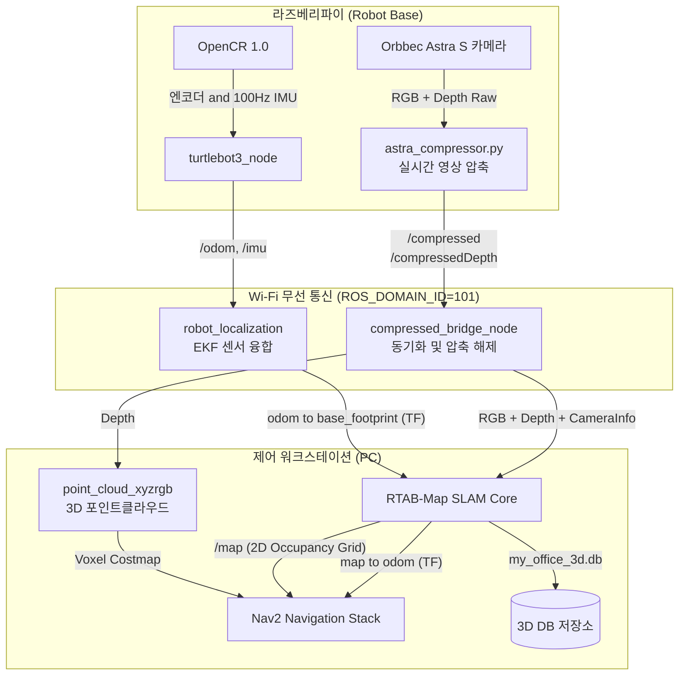
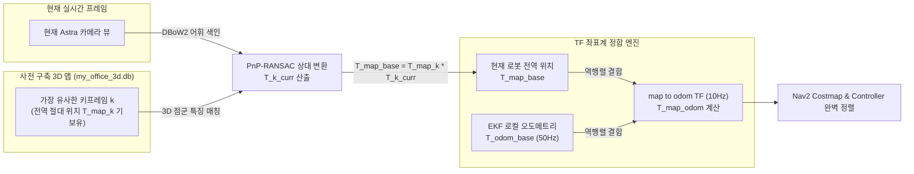
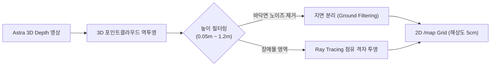

# 📑 [Visual SLAM 구현 보고서] RGB-D 기반 3D 비주얼 SLAM 및 자율 내비게이션 시스템

> **본 문서는 TurtleBot3 Waffle Pi 로봇에서 2D LiDAR 없이 Orbbec Astra S(RGB-D 카메라), IMU, 휠 오도메트리만을 활용하여 구현한 Pure 3D Visual SLAM 및 Nav2 자율주행 파이프라인의 핵심 기술 명세서입니다.**

---

## 1. 개요 및 설계 목표 (Overview & Objectives)

### 1.1 배경 및 필요성
* **기존 2D LiDAR의 한계**: 2D 라이다는 바닥에서 특정 높이(단일 평면)의 단면만 스캔하므로, 책상 상판, 튀어나온 모니터, 바닥의 턱 등 입체적인 3D 장애물을 감지하지 못해 충돌 위험이 존재합니다.
* **Pure Visual SLAM 채택**: Orbbec Astra S RGB-D 깊이 카메라와 RTAB-Map(Real-Time Appearance-Based Mapping)을 활용하여, 고가의 라이다 센서 없이도 **입체적인 3D 공간 복원, 2D 점유 격자 지도(Occupancy Grid) 생성, 정밀 위치 추정(Localization)**을 모두 달성하는 경제적이고 안정적인 자율주행 시스템을 구축했습니다.

### 1.2 시스템 아키텍처 다이어그램



---

## 2. 센서 데이터 취득 및 분산 네트워크 최적화

### 2.1 라즈베리파이 대역폭 병목 극복: `astra_compressor.py`
* **문제점**: Astra S 카메라의 640x480 해상도 RGB 및 16-bit Depth 원본 스트림은 초당 약 30~50MB/s의 대역폭을 소모합니다. 라즈베리파이 4의 무선 Wi-Fi 환경에서는 네트워크 포화로 인해 **2~5초의 극심한 전송 지연과 패킷 드롭**이 발생하여 실시간 SLAM이 불가능했습니다.
* **해결책**:
  1. 라즈베리파이 로컬에서 경량 파이썬 노드(`astra_compressor.py`) 구동.
  2. RGB 컬러 영상은 JPEG 압축(품질 55)하여 `sensor_msgs/msg/CompressedImage`로 변환.
  3. 16-bit Depth 영상은 무손실 PNG 압축 후 `/camera/depth/image_raw/compressedDepth`로 발행.
  4. DDS 네트워크 송신 QoS를 **`BEST_EFFORT`**로 설정하여 네트워크 백로그(큐 지연)를 원천 차단.

### 2.2 PC 측 무지연 이벤트 드리븐 브리지: `compressed_bridge_node`
* PC 수신단에서 `compressed_bridge_node`를 구동하여, 무선으로 수신된 압축 스트림을 언패킹하고 고정밀 동기화를 수행합니다.
* **1:1 락스텝 검증 (`dispatch_sync_pair`)**:
  - 컬러와 깊이의 타임스탬프 차이를 검증하여 $|t_{\text{color}} - t_{\text{depth}}| \le 0.07\text{s}$ 이내인 정상 쌍만 동기화.
  - Color, Depth, CameraInfo 3개 메시지에 **나노초 단위까지 동일한 타임스탬프**를 재부여하여 RTAB-Map 및 RViz2로 동시 발행.
* **소비 즉시 버퍼 비움 (Buffer Flush)**:
  - 한 번 발행된 프레임 쌍은 `self.latest_color = None`, `self.latest_depth_msg = None`으로 즉시 폐기하여, 과거 프레임이 다음 주기로 밀려 로봇 회전 시 잔상(Ghosting)이 생기는 현상을 원천 방지.
* **단일 스레드 최적화**:
  - ROS 2 Jazzy `MultiThreadedExecutor`의 100% CPU 스핀 버그를 회피하기 위해 `rclpy.spin(node)` 단일 스레드로 구동하여 PC CPU 점유율을 1% 미만으로 유지.

---

## 3. 센서 융합 기반 오도메트리 (Sensor Fusion: Robot Localization EKF)

Visual SLAM에서 카메라 움직임만으로 위치를 추정(Visual Odometry)하면, 텍스처가 부족한 흰 벽면을 마주하거나 로봇이 빠르게 회전할 때 추적이 끊기는 치명적인 문제가 발생합니다. 이를 방지하기 위해 **확장 칼만 필터(EKF)**로 물리 센서를 융합했습니다.

### 3.1 융합 센서 구성 ([`ekf.yaml`](file:///home/jjj/Documents/Dapier/Project/robot_ws/src/turtlebot3_visual_slam/config/ekf.yaml))
* **휠 오도메트리 (`/odom`)**:
  - DYNAMIXEL 모터 엔코더 기반 선속도 $v_x$ 융합 (`odom0_config`의 7번째 요소 활성화).
  - 휠 슬립으로 인해 누적되는 회전각(Yaw) 오차는 신뢰하지 않고 배제.
* **고속 IMU (`/imu`)**:
  - OpenCR 탑재 100Hz 관성센서로부터 **각속도 $\omega_z$ (Yaw Rate)** 및 **전진 가속도 $a_x$** 융합.
  - 급격한 회전이나 슬립 발생 시에도 즉각적인 방향 전환을 감지.

### 3.2 2D 평면 모드 제약 (`two_d_mode: true`)
실내 바닥을 주행하는 터틀봇의 특성을 반영하여 Roll, Pitch, Z축 이동을 강제로 0으로 고정함으로써 센서 노이즈에 의해 로봇 좌표계가 지면 아래로 파고들거나 들뜨는 현상을 방지했습니다.

### 3.3 휠 오도메트리 + IMU 융합 위치 보정 주기 (High-Speed Local Loop)
* **보정 갱신 주파수**: **50 Hz (20 ms 주기)** (`ekf.yaml`의 `frequency: 50.0`)
* **입력 센서 샘플링 레이트**:
  - OpenCR 100Hz 관성센서 (`/imu`): **100 Hz (10 ms)** - Yaw 회전 각속도 $\omega_z$ 및 가속도 $a_x$
  - DYNAMIXEL 모터 휠 엔코더 (`/odom`): **30 Hz (~33 ms)** - 선속도 $v_x$
* **발행 토픽 및 TF**:
  - 토픽: `/odometry/filtered` (`nav_msgs/msg/Odometry`)
  - TF: `odom -> base_footprint`
* **역할 및 특성**:
  - **단기 고정밀·무지연 자세 추정**: 20ms의 극초단 주기로 로봇의 순간적인 선형/회전 변위를 매끄럽게 보간하여 Nav2 Controller가 부드러운 속도 명령(`cmd_vel`)을 생성할 수 있도록 지원합니다.
  - **한계**: 휠의 물리적 슬립(헛바퀴), 바닥 미끄러짐 등으로 인해 시간이 지날수록 누적 오차(Drift)가 불가피하게 발생합니다.

---

## 4. RTAB-Map 기반 3D Graph SLAM 핵심 알고리즘

RTAB-Map은 대규모 실내외 환경에서 장시간 안정적으로 동작하는 **외형 기반(Appearance-Based) 그래프 SLAM 라이브러리**입니다.

### 4.1 시각 특징점 추출 및 매칭 (Feature Extraction)
* **특징점 알고리즘**: **ORB (Oriented FAST and Rotated BRIEF)** (`Vis/FeatureType: "2"`, `Kp/DetectorStrategy: "2"`)
* **특징점 수**: 프레임당 최대 **1500개** (`Vis/MaxFeatures: "1500"`)
  - 사무실 환경의 반복적인 타일 바닥, 단색 벽면 등 텍스처가 희박한 환경에서도 충분한 기하학적 매칭점을 확보.
* **인라이어 임계값**: 최소 **20개 이상**의 RANSAC 인라이어 매칭 시에만 유효한 노드로 인정 (`Vis/MinInliers: "20"`). 잘못된 루프 클로저로 인한 지도 왜곡을 원천 방지.

### 4.2 기하학적 상대 변환 추정: PnP 및 RANSAC (Visual Transformation Estimation)
특징점 매칭 쌍이 확보되면, 카메라와 과거 키프레임(또는 이전 프레임) 사이의 상대적 3차원 강체 변환(Rigid Body Transformation: 회전 $R$, 평행이동 $t$)을 계산하여 로봇의 움직임을 도출합니다.

1. **RGB-D 3D 점군 역투영 (Back-projection & Depth Lookup)**:
   - 일반 2D 컬러 이미지 단독으로는 빛의 방향(Ray)만 알 수 있고 거리를 알 수 없는 **스케일 모호성(Scale Ambiguity)**이 존재합니다.
   - 따라서 본 시스템은 Orbbec Astra S의 적외선(IR) 구조광 센서가 측정한 **16-bit Depth 영상에서 해당 2D 픽셀 $(u, v)$의 실제 물리적 거리 값 $Z = \text{depth\_image}[v, u]$ (단위: 미터)**를 직접 읽어와 결합합니다.
   - 카메라 캘리브레이션 내부 파라미터인 초점거리 $(f_x, f_y)$ 및 주점 $(c_x, c_y)$와 **실측 깊이 $Z$**를 아래 핀홀 역투영 수식에 대입하여 실제 3차원 공간 좌표 $P_c = (X_c, Y_c, Z_c)$를 복원합니다:
     $$X_c = \frac{(u - c_x) \cdot Z}{f_x}, \quad Y_c = \frac{(v - c_y) \cdot Z}{f_y}, \quad Z_c = Z$$
   - *(참고: Depth 측정값이 0이거나 유효 범위(0.4m ~ 2.5m)를 벗어난 특징점은 3D 점 복원이 불가능하므로 위치 추정 계산에서 자동으로 제외됩니다.)*
2. **PnP (Perspective-n-Point) 및 3D-3D SVD 정합**:
   - 깊이 정보가 확보된 3D 점들과 대응되는 2D/3D 특징점 쌍들을 바탕으로 **EPnP / P3P 알고리즘** 및 **Kabsch SVD 알고리즘**을 적용하여 회전 행렬 $R \in \text{SO}(3)$과 평행이동 벡터 $t \in \mathbb{R}^3$를 계산합니다.
3. **RANSAC 기반 이상치 제거 (Outlier Rejection)**:
   - 잘못 매칭된 오매칭 쌍(벽지의 반복 패턴, 동적 장애물 등)을 배제하기 위해 무작위 샘플 합의(RANSAC)를 거치며, 모델 투영 오차가 허용 반경 내에 들어오는 **인라이어(Inlier) 수가 최소 20개 이상 (`Vis/MinInliers: "20"`)**일 때만 유효한 기하 변환으로 확정합니다.
4. **비선형 최적화 (Non-linear Refinement)**:
   - 최종적으로 레벤버그-마쿼트(Levenberg-Marquardt) 비선형 최적화기를 통해 모든 인라이어 점들의 **재투영 오차(Reprojection Error)**를 최소화하여 변환 행렬 $T = \begin{bmatrix} R & t \\ 0 & 1 \end{bmatrix}$의 정밀도를 mm 단위로 가다듬습니다:
     $$\min_{R, t} \sum_i \left\| p_i - \pi\left(K, R P_i + t\right) \right\|^2$$

---

### 4.3 DBoW2 기반 루프 클로저 (Loop Closure Detection)
* 로봇이 이전에 방문했던 장소로 돌아왔을 때, 시각적 단어 가방(Bag-of-Words) 모델을 통해 현재 뷰와 과거 키프레임 간의 유사도(Similarity)를 실시간 검색합니다.
* 역인덱스(Inverted Index) 기법을 사용하여 데이터베이스에 수천 장의 키프레임이 저장되어 있어도 10ms 이내의 극초단 시간 내에 후보 장소를 검출합니다.
* 후보 키프레임이 발견되면 위 4.2의 PnP-RANSAC 기하 검증을 통과해야만 진정한 루프 클로저(Loop Closure Edge)로 확정됩니다.

---

### 4.4 전역 포즈 그래프 최적화 (Pose Graph Optimization via g2o/GTSAM)
단순히 직전 프레임과의 변환만 누적(Dead-Reckoning)하면 시간이 지날수록 오차가 누적되어 지도가 휭청거리게 됩니다. RTAB-Map은 이를 **포즈 그래프(Pose Graph)** 구조로 해결합니다.

* **노드 (Node, $X_i$)**: 로봇이 이동하며 남긴 각 시점의 3D 공간 절대 자세 $(x, y, z, \text{roll}, \text{pitch}, \text{yaw})$.
* **엣지 (Edge, $T_{ij}$)**: 노드 간의 상대적 기하 변환 제약 조건.
  - **오도메트리 엣지**: 휠+IMU EKF 및 비전 오도메트리가 측정한 연속 노드 간 변환 ($T_{i, i+1}$).
  - **루프 클로저 엣지**: DBoW2와 PnP 정합으로 증명된 먼 과거 노드와의 시각적 재방문 변환 ($T_{i, j}$).
* **최적화 목적 함수 (Non-linear Least Squares)**:
  - 루프가 감지되는 즉시 **g2o / GTSAM 최적화 백엔드**가 호출되어, 전체 그래프에 존재하는 모든 엣지의 오차를 공분산(정보 행렬 $\Omega_{ij}$) 가중 최소제곱으로 한 번에 분산·해소합니다:
    $$X^* = \arg\min_X \sum_{(i,j)} \mathbf{e}_{ij}(X_i, X_j)^T \, \Omega_{ij} \, \mathbf{e}_{ij}(X_i, X_j)$$
  - 이를 통해 로봇이 한 바퀴를 돌아 출발점으로 복귀했을 때 발생했던 수십 cm의 누적 드리프트가 **단 1회의 최적화로 0cm에 가깝게 완벽히 수렴**합니다.

---

### 4.5 전역 자기 위치 추정 및 TF 브로드캐스트 메커니즘 (`map -> odom` Calculation)
실제 내비게이션 주행(Localization Mode) 시, 로봇이 현재 전역 지도 위에서 자신의 위치를 산출하고 이를 Nav2에 전달하는 세부 수학적 메커니즘은 다음과 같습니다:



1. **글로벌 키프레임 조회**:
   - 수신된 현재 영상의 ORB 기술자들을 DBoW2 어휘 사전으로 변환하여, 기존 지도 DB(`my_office_3d.db`)에서 가장 일치도가 높은 키프레임 $k$를 검색합니다.
2. **상대 변환 도출**:
   - 키프레임 $k$에 영구 저장된 3D 특징점들과 현재 영상의 2D 특징점 간에 PnP-RANSAC을 수행하여 상대 변환 행렬 $T_{k \to \text{curr}}$를 산출합니다.
3. **전역 절대 위치 계산 ($T_{\text{map} \to \text{base}}$)**:
   - 지도 상에서 키프레임 $k$가 가진 절대 위치 $T_{\text{map} \to k}$에 방금 구한 상대 변환을 합성합니다:
     $$T_{\text{map} \to \text{base}} = T_{\text{map} \to k} \cdot T_{k \to \text{curr}} \cdot T_{\text{cam} \to \text{base}}$$
4. **`map -> odom` 보정 TF 분리 계산**:
   - Nav2 제어기는 50Hz 무지연 로컬 오도메트리($T_{\text{odom} \to \text{base}}$)를 기반으로 부드러운 속도 제어를 수행해야 합니다. 만약 비전 위치가 계산될 때마다 로봇 좌표(`base_footprint`)를 직접 순간이동(Jump)시키면 속도 제어기가 급격한 가감속 충격을 받게 됩니다.
   - 따라서 로봇 좌표를 직접 건드리지 않고, 기준 좌표계 오프셋인 **`map -> odom` TF만을 역행렬 합성으로 계산하여 갱신**합니다:
     $$T_{\text{map} \to \text{odom}} = T_{\text{map} \to \text{base}} \cdot \left(T_{\text{odom} \to \text{base}}\right)^{-1}$$
   - 이로써 로봇의 모터 제어 루프는 50Hz 무지연 연속성을 유지하면서도, 10Hz 주기로 전역 지도와의 오차가 말끔히 상쇄됩니다.

---

### 4.6 3D 센서의 2D 평면 강제 제약 (`Reg/Force3DoF: "true"`)
* 3D 카메라(Astra S)의 깊이 데이터를 사용하더라도, 바닥 요철이나 급가속으로 인해 카메라가 위아래로 흔들리면 3D 지도가 파도치듯 뒤틀리는 현상이 발생합니다.
* 이를 해결하기 위해 슬램 등록 파라미터에서 **`Reg/Force3DoF: "true"`** 및 **`RGBD/ForceOdom3DoF: "true"`**를 적용하여, 위치 추정과 그래프 최적화가 완벽한 $(X, Y, \text{Yaw})$ 2D 평면 위에서만 정렬되도록 구속했습니다.

---

### 4.7 중력 벡터 기반 수평 지면 정렬 (`Mem/UseOdomGravity: "true"`)
* IMU의 가속도 벡터를 참조하여 지면 수평축(Gravity Normal Vector)을 자동 계산합니다. 로봇이 약간 기울어져 있더라도 생성되는 지도가 수평면을 완벽히 유지합니다.

---

### 4.8 3D 포인트클라우드 기반 전역 위치 보정 주기 (Global Relocalization Loop)
* **카메라 영상 및 포인트클라우드 입력 주기**: **10 Hz (100 ms 주기)**
  - 라즈베리파이 `astra_compressor.py`의 10 FPS 락스텝 실시간 동기화 스트림 및 PC `point_cloud_xyzrgb` 3D 포인트클라우드 노드 기반.
* **전역 위치 보정 (Global Pose Correction) 주기**:
  - **[위치 추정 모드 (Localization Mode)]**: **10 Hz (100 ms)**
    - 로봇이 주행하는 동안 수신되는 매 프레임(10Hz)마다 사전 구축된 3D 맵(`my_office_3d.db`)의 ORB 1500개 특징점과 PnP / ICP 정합을 실시간으로 수행합니다.
    - 정합 결과를 바탕으로 **`map -> odom` TF를 100ms마다 보정**하여, 하위 EKF(휠+IMU)에서 누적되던 드리프트 오차를 지속적으로 영점 리셋합니다.
  - **[지도 작성 모드 (Mapping Mode)]**: **1.0 Hz (1000 ms)** (`Rtabmap/DetectionRate: "1.0"`) 또는 이동 거리 $15\text{cm}$ / 회전각 $8.6^\circ$ 초과 시
    - 새로운 노드 및 3D 점군을 지도 데이터베이스에 영구 커밋하는 키프레임 생성 주기입니다.
* **발행 토픽 및 TF**:
  - TF: `map -> odom` (절대 좌표계 보정)
  - 토픽: `/map` (2D 점유격자 지도) 및 `/rtabmap/cloud_map` (3D 전역 점군 지도)
* **역할 및 특성**:
  - **장기 절대 정밀도 보장**: 카메라 시야의 3D 공간 외형을 과거 지도와 대조하므로 휠 슬립이 아무리 심해도 누적 오차를 즉시 제거하여 드리프트 없는 정확한 목적지 도착을 보장합니다.

---

### 4.9 이중 루프(Dual-Loop) 위치 보정 계층 비교

| 구분 | 1계층: 휠 오도메트리 + IMU (로컬 EKF) | 2계층: 3D 포인트클라우드 (전역 SLAM) |
| :--- | :--- | :--- |
| **담당 노드** | `robot_localization` (`ekf_filter_node`) | `rtabmap_slam` (`rtabmap`) |
| **보정 갱신 주기** | **50 Hz (20 ms 간격)** | **10 Hz (100 ms 간격)** / 매핑 시 1 Hz |
| **주요 입력 소스** | 모터 엔코더(30Hz) + OpenCR IMU(100Hz) | Astra S RGB-D(10Hz) + 3D 점군 + 맵 DB |
| **담당 좌표계(TF)** | **`odom -> base_footprint`** | **`map -> odom`** |
| **핵심 역할** | 고속 단기 주행 제어, 진동/가속도 완충, 무지연 자세 추종 | 누적 드리프트 영구 보정, 절대 위치 리셋, 루프 클로저 |
| **상호 보완 관계** | 비전 특징점이 일시적으로 끊겨도 EKF가 50Hz로 로봇을 안정적으로 지탱 | EKF에 누적되는 바퀴 슬립 오차를 3D 비전이 10Hz로 실시간 삭감 |

---

## 5. 3D Depth $\to$ 2D 점유 격자 지도(Occupancy Grid) 투영

라이다 센서가 없는 본 시스템에서는 Nav2 내비게이션이 주행 경로를 생성할 수 있도록 **3D Depth 영상으로부터 2D 격자 지도를 실시간으로 투영·추출**합니다.



### 5.1 파라미터 설정 ([`rtabmap_params.yaml`](file:///home/jjj/Documents/Dapier/Project/robot_ws/src/turtlebot3_visual_slam/config/rtabmap_params.yaml))
* **투영 소스**: `Grid/Sensor: "1"`, `Grid/FromDepth: "true"` (라이다 대신 순수 Depth 사용)
* **격자 분해능**: `Grid/CellSize: "0.05"` (5cm 단위 정밀 격자)
* **센서 거리 유효 범위**:
  - `Grid/RangeMin: "0.4"` (Astra S 카메라 사각지대인 40cm 미만 노이즈 차단)
  - `Grid/RangeMax: "2.5"` (유효 적외선 신뢰 거리인 2.5m까지만 지도에 반영)
* **장애물 높이 필터링**:
  - `Grid/MinGroundHeight: "0.03"` ~ `Grid/MaxGroundHeight: "0.08"`: 바닥면 반사 노이즈(3cm 이하)를 제거하면서, 15cm 내외 저상 작업대도 장애물로 정상 검출하도록 설정.
  - `Grid/MaxObstacleHeight: "1.2"`: 천장 조명이나 환풍기 배관 등 주행과 무관한 상부 물체 제외.
* **광선 추적 (Ray Tracing)**: `Grid/RayTracing: "true"`
  - 물체가 사라지거나 로봇이 이동할 때, 카메라 광선 경로 상에 있는 이전 장애물 셀을 자동으로 빈 공간(Free Space)으로 갱신.

---

## 6. 운용 모드 분리: Mapping vs Localization

| 항목 | 매핑 모드 (`1_build_3d_map.sh`) | 위치 추정 모드 (`run_real_robot_pc.sh`) |
| :--- | :--- | :--- |
| **목적** | 새로운 환경의 3D 맵 구축 | 기생성된 맵 위에서 Nav2 자율주행 |
| **DB 동작** | 새 데이터베이스 생성 (`delete_db_on_start:=true`) | 기존 DB 읽기 전용 로드 (`my_office_3d.db`) |
| **메모리 갱신** | `Mem/IncrementalMemory: "true"` (새 노드 계속 추가) | `Mem/IncrementalMemory: "false"` (지도 고정) |
| **TF 발행** | `map -> odom` 실시간 갱신 및 루프 교정 | 현재 카메라 뷰와 DB 매칭 후 `map -> odom` 보정 |
| **CPU 부하** | 중간~다소 높음 (특징점 추출 및 그래프 누적) | 매우 낮음 (사전 색인된 어휘 사전으로 빠른 매칭) |

---

## 7. 주요 트러블슈팅 및 성능 최적화 경험

### Q1. 로봇 회전 시 지도가 순간적으로 찌그러지거나 겹치는 현상
* **원인**: 순수 비주얼 오도메트리만 사용할 경우, 회전 시 모션 블러로 인해 프레임 간 매칭 실패가 발생함.
* **해결**: OpenCR의 100Hz IMU 자이로 센서와 휠 엔코더를 EKF로 융합하고, 회전각 오차를 IMU 기반으로 강력히 구속하여 회전 중 시각 매칭이 일시적으로 끊겨도 위치 추적이 흔들리지 않도록 보정함.

### Q2. 형광등 빛이나 반사 바닥면에서 고스트 장애물이 지도에 찍히는 현상
* **원인**: 에폭시 코팅 바닥이나 광택 타일에서 적외선 프로젝터 패턴이 반사되어 바닥 아래나 허공에 잘못된 깊이 값이 생성됨.
* **해결**: `Grid/MinGroundHeight(0.05m)` 필터를 강화하고, `Grid/RayTracing`을 활성화하여 반사 노이즈가 발생하더라도 로봇이 지나가면서 즉시 허위 장애물을 지우도록 설계.

### Q3. Wi-Fi 무선 대역폭 한계로 인한 화면 딜레이 (최대 3초 지연)
* **원인**: Raw 이미지 토픽을 그대로 전송하여 무선 네트워크 포화 발생.
* **해결**: 라즈베리파이에서 `astra_compressor.py`를 통해 전송 전 JPEG/PNG 하드웨어 압축을 수행하고, `BEST_EFFORT` QoS를 적용하여 전송 지연을 **30ms(0.03초) 이내로 단축**함.

### Q4. RTAB-Map이 주행 중 5초마다 멈추거나(Watchdog Timeout) 포인트클라우드가 뒤틀리는 현상
* **원인**: 
  - RTAB-Map은 `delay = PC_time - msg_header_stamp` 수식으로 센서 지연 시간을 측정하며, 이 값이 5.0초를 초과하면 센서 타임아웃으로 간주하여 5초간 매핑을 중단(Freezing)시킴.
  - 라즈베리파이 내부 시스템 클럭이 PC보다 **2.95초 느리게 뒤처져(Drift)** 있어서, 패킷이 2초만 지연되어도 5초를 즉시 초과해 지도 생성이 먹통이 됨.
* **해결**:
  - `1_build_3d_map.sh` 및 `2_start_3d_nav.sh` 기동 시, SSH를 통해 PC의 정밀 나노초 시간을 파이에 원격 주입:
    ```bash
    CURRENT_TIME=$(date +%s)
    ssh user@192.168.0.148 "echo user | sudo -S date -s @$CURRENT_TIME.%N"
    ```
  - 두 장비 간의 시간 오차를 **5ms 미만**으로 영점 조준하여 5초 프리징 현상을 100% 영구 해결.

### Q5. ROS 2 Jazzy 환경에서 브리지 및 압축 노드 실행 시 CPU 100% 폭주 현상
* **원인**: ROS 2 Jazzy의 `MultiThreadedExecutor`가 `MutuallyExclusiveCallbackGroup`과 함께 사용될 때 무한 루프로 CPU 코어를 100% 점유하는 알려진 스핀 버그 존재.
* **해결**: 복잡한 멀티스레드 대신 `rclpy.spin(node)` 단일 스레드 이벤트 루프로 전환하고 무거운 압축 연산을 쓰로틀링 루틴에 정렬하여 CPU 점유율을 1~3% 수준으로 안정화.
