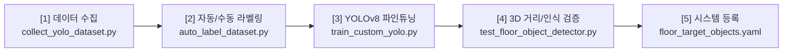

# 🎯 YOLO 타겟 물체 등록 & 파인튜닝 파이프라인 가이드

본 문서는 TurtleBot3 바닥 물체 정밀 접근 시스템을 위한 **새로운 물체 등록, 데이터셋 수집, 자동 라벨링, YOLOv8 파인튜닝, 3D 검증**까지의 원스톱 워크플로우를 설명합니다.

---

## 📌 파이프라인 개요

`Project/tools/yolo_training/` 디렉토리에 포함된 스크립트를 사용하여 바닥에 놓인 새로운 물체(큐브, 공, 볼트, 도구 등)를 손쉽게 학습하고 로봇 제어 시스템에 즉시 등록할 수 있습니다.



---

## 🛠️ Step 1: 실시간 데이터셋 수집 (`collect_yolo_dataset.py`)

Astra S 카메라의 실시간 영상 스트림을 보면서 다양한 각도, 조명, 거리에서 물체 이미지를 수집합니다.

### 실행 방법
```bash
# 기본 실행 (Project 루트에서 실행 권장)
python3 tools/yolo_training/collect_yolo_dataset.py --label black_cube

# 또는 특정 출력 폴더 지정
python3 tools/yolo_training/collect_yolo_dataset.py --output dataset_capture --label black_rod
```

### 주요 기능 및 단축키
* **`[SPACE]` (수동 캡처)**: 현재 프레임을 즉시 캡처하여 저장합니다.
* **`[A]` (인터벌 자동 캡처 ON/OFF)**: 0.8초 간격으로 로봇 또는 물체를 조금씩 움직이며 자동으로 연속 캡처합니다.
* **`[V]` (동영상 녹화 ON/OFF)**: 실시간 동영상(`.mp4`)으로 녹화합니다. 녹화 종료 시 블러(흐림) 필터링이 자동 적용되어 선명한 프레임만 이미지로 추출됩니다.
* **`[TAB]` (라벨 순환 변경)**: `red_cube` $\to$ `blue_ball` $\to$ `black_cube` $\to$ `black_rod` 등 등록된 클래스를 실시간 전환합니다.
* **`[C]` (새 클래스 이름 입력)**: 터미널에서 새로운 라벨 이름을 즉시 입력하여 추가합니다.
* **`[Q]` 또는 `[ESC]`**: 수집기를 종료합니다.

> [!TIP]
> **고품질 데이터셋 수집 팁**:
> - 물체와의 거리를 30cm, 50cm, 1m, 1.5m 등 다양하게 배치하세요.
> - 카메라 시야의 중앙뿐 아니라 좌/우 외곽 구석에도 배치하여 렌즈 왜곡에 대한 강건성을 확보하세요.
> - 클래스당 최소 40~60장의 다양한 이미지를 수집하는 것을 권장합니다.

---

## 🏷️ Step 2: 자동 바운딩 박스 라벨링 (`auto_label_dataset.py`)

수집된 이미지들에 대해 YOLO-World 오픈 보캐블러리 모델이 1차 바운딩 박스를 자동으로 제안하며, 사용자가 직관적인 3X 확대 GUI에서 편리하게 검토 및 수정합니다.

### 실행 방법
```bash
python3 tools/yolo_training/auto_label_dataset.py \
    --input dataset_capture/images \
    --output dataset_capture/yolo_dataset
```

### 주요 인터페이스 & 조작법
* **3X 확대 뷰포트 (960x720)**: 320x240 저해상도 원거리 물체도 큼직하게 확대되어 마우스 지정이 매우 편리합니다.
* **유연한 마우스 드래그 지원**:
  - `클릭 앤 드래그`: 좌클릭 누른 채 드래그하여 박스 생성.
  - `투-클릭 (Two-Click)`: 한쪽 모서리 클릭 후 반대쪽 모서리 클릭으로 생성.
* **우클릭 즉시 삭제**: 잘못 그려진 박스 위에서 마우스 우클릭 시 해당 박스만 즉시 삭제됩니다.
* **단축키**:
  - `[SPACE]` 또는 `[ENTER]`: 현재 라벨 승인 및 다음 이미지 이동.
  - `[0], [1], [2], [3]`: 활성 클래스 전환 (0: red_cube, 1: blue_ball, 2: black_cube, 3: black_rod).
  - `[Z]`: 마지막 작업 실행 취소 (Undo).
  - `[D]`: 현재 이미지의 모든 박스 전체 삭제.
  - `[B]`: 이전 이미지로 되돌아가기.
* **자동 YOLO 포맷 분할**:
  - 검토 완료 시 `train` (80%) 및 `val` (20%) 세트로 자동 분할되며, `data.yaml` 설정 파일이 자동 생성됩니다.

---

## 🚀 Step 3: YOLOv8 파인튜닝 학습 (`train_custom_yolo.py`)

GPU 가속(RTX 5050 등)을 사용하여 바닥 소형 물체에 최적화된 하이퍼파라미터로 파인튜닝을 수행합니다.

### 실행 방법
```bash
python3 tools/yolo_training/train_custom_yolo.py --epochs 60 --batch 16 --imgsz 320
```

### 소형 바닥 물체 특화 증강 기법 (Augmentation)
* **Mosaic = 1.0**: 4장의 이미지를 무작위 합성하여 원거리 축소 효과를 시뮬레이션합니다 (원거리 소형 물체 검출력 대폭 향상).
* **Scale Jitter (0.5x ~ 1.5x)**: 물체 크기 변화에 대한 내성을 극대화합니다.
* **HSV 변형 (Color/Brightness)**: 실내 조명 반사, 그림자, 역광에 강건하도록 색조/채도/명도를 무작위 변화시킵니다.

### 결과물 및 배포
* 학습 결과는 `Project/robot_runs/custom_floor_detector/`에 저장됩니다 (`results.png`, `confusion_matrix.png` 등).
* 최적 성능 가중치(`best.pt`)는 **`Project/custom_floor_detector_best.pt`**로 자동 복사 및 배포되어 즉시 로봇 구동 시 반영됩니다.

---

## 🔍 Step 4: 무동작 3D 검출 & 거리 측정 검증 (`test_floor_object_detector.py`)

학습된 모델이 실제 Astra S 카메라 영상에서 정확한 거리(Z)와 좌우 편차(Ey)를 측정하는지 로봇을 주행시키지 않고 안전하게 검증합니다.

### 실행 방법
```bash
python3 tools/yolo_training/test_floor_object_detector.py
```

### 확인 사항
* 카메라가 자동으로 백그라운드 구동(320x240 RGB-D)됩니다.
* 바닥에 학습된 물체를 놓았을 때 Bounding Box 테두리가 잡히고 `Z=0.xx m` 거리가 측정되는지 확인합니다.
* 줄자나 자로 잰 실제 거리와 화면 상의 `Z` 거리가 $\pm 2\text{cm}$ 오차 이내로 일치하는지 대조합니다.
* `[S]` 키를 누르면 현재 검출 상태가 `target_images/`에 스냅샷으로 저장됩니다.

---

## 📄 Step 5: 시스템 선언적 등록 (`floor_target_objects.yaml`)

파이썬 소스코드를 단 한 줄도 수정할 필요 없이, 설정 파일에 신규 타겟을 선언하면 전체 내비게이션, LLM 자연어 음성 명령, GUI 버튼에 즉시 연동됩니다.

### 설정 파일 위치
`Project/robot_ws/src/llm_semantic_docker/config/floor_target_objects.yaml`

### 등록 예시
```yaml
targets:
  black_cube:
    canonical_id: "black_cube"
    display_name: "검은 큐브"
    aliases:
      - "black_cube"
      - "black cube"
      - "검은 큐브"
      - "검은큐브"
      - "검정 큐브"
      - "검은 상자"
    standoff_m: 0.25                # 목표 최종 접근 정지 거리 (25cm)
    arm_reach_range_m: [0.18, 0.28]  # 로봇팔 작업 유효 거리 (18~28cm)
    expected_width_m: 0.055          # 실제 물리적 폭 (5.5cm)
    approach_speed_m_s: 0.065        # 접근 순항 선속도 (m/s)
```

등록 후 `colcon build --packages-select llm_semantic_docker`를 1회 실행해주시면 `./3_start_nav_docker.sh`에서 다음 기능이 즉시 활성화됩니다:
1. **자연어 명령 인식**: `"검은 큐브 앞으로 가줘"`, `"black_cube 접근"` 등 음성/채팅 명령 지원.
2. **자율주행 중 자동 발견**: Nav2 순찰 주행 중 전방 2m 이내에 발견 시 주행을 멈추고 픽업 여부 승인 창 팝업.
3. **정밀 비주얼 서보잉**: 25cm 스탠드오프 지점까지 오차 $\pm 2\text{cm}$ 이내로 자동 정밀 감속 접근.
